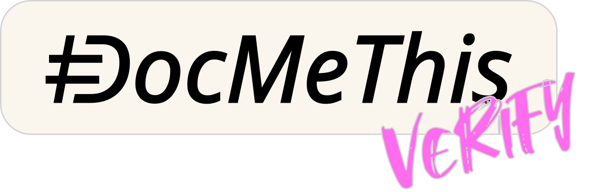

<p align="center">
  <a href="https://docmethis.com">
    <picture>
      
    </picture>
  </a>
</p>

<p align="center">
  <em>DocMeThis Verify is a <a href="https://docmethis.com">DocMeThis</a> project, part of the <a href="https://github.com/orgs/DocMeThis/repositories">DocMeThis suite</a>.</em>
</p>

# DocMeThis Verify

[](https://github.com/DocMeThis/docmethis-verify/actions/workflows/ci.yml)
[](LICENSE)

**Verify documentation against extracted code facts.**

DocMeThis Verify is the deterministic verification layer between code analysis,
documentation parsing and downstream automation. It is designed to
remain independent of a programming language and a documentation format:
language adapters provide code facts, documentation adapters provide a canonical
document model, and Verify returns structured findings.

The public MVP ships the first adapter for Python source and NumPy-style
docstrings. Python is the current implementation, not the boundary of the
verification model.

```text
Language facts + documentation model
    -> canonical Verify request
        -> deterministic verification rules
            -> structured errors + format warnings
                -> Check, Fix or another consumer
```

- **Language-neutral boundary:** code facts are supplied by an adapter.
- **Format-neutral boundary:** documentation is supplied as a canonical model.
- **Deterministic:** identical facts and documentation produce identical results.
- **Structured:** findings preserve codes, sections, granularity and identity fields.
- **Side-effect free:** Verify does not write source files or contact external services.
- **Composable:** consumers can apply their own diff, severity and remediation policy.

## How It Works

1. A language adapter extracts the facts relevant to a documented symbol.
2. A documentation adapter parses the source or generated document into the canonical model.
3. A `VerificationRequest` combines both representations and any verification policy.
4. Deterministic rules compare documented claims with extracted facts.
5. A structured response separates verification errors from format warnings.

Verify does not decide whether a finding blocks a release. [DocMeThis Check](https://github.com/DocMeThis/docmethis-check), [DocMeThis Fix](https://docmethis.com/en/ci-fix/start) or another
consumer applies that policy at its own boundary.

## Current Python Adapter

The public MVP currently provides:

| Boundary | Current adapter |
| --- | --- |
| Code facts | `docmethis-extract-python` records |
| Documentation format | NumPy-style docstrings |
| Runtime | Python 3.12+ |
| Input records | `FunctionRecord` and `ClassRecord` |
| Output | `VerificationError` and `FormatWarning` |

The adapter is intentionally kept behind the Verify contract so future
implementations can add other language and documentation ecosystems without
changing the consumer workflow.

## Quick Start: Python + NumPy

### Python MVP Installation

The public MVP requires the matching `docmethis-extract-python` package. Install
both packages from their published distributions:

```bash
python3.12 -m venv .venv
. .venv/bin/activate
python -m pip install docmethis-verify
```

On Windows, activate the environment with `.venv\Scripts\Activate.ps1`.

### Python Adapter Example

The following example uses the current Python adapter. Other adapters will use
the same request/response boundary with their own fact and document models.

```python
from pathlib import Path

from docmethis_extract_python.api import analyze_project, iter_functions
from docmethis_verify import VerificationRequest
from docmethis_verify.docstring.models import GeneratedDocstring
from docmethis_verify.verification.verifier import verify

project = analyze_project(Path("src"), skip_dynamic=True)
record = next(iter_functions(project.modules))

request = VerificationRequest(
    function_record=record,
    generated_docstring=GeneratedDocstring(
        summary="Return the configured value.",
        parameters=(),
    ),
    forbidden_terms=("always", "guarantees"),
)
response = verify(request)

for error in response.errors:
    print(error.dmt_code, error.section, error.detail)

for warning in response.warnings:
    print(warning.kind, warning.section, warning.detail)
```

`response.is_valid` is false when structural verification errors exist. Format
warnings remain separate so the consuming product can apply its own policy.

## Verification Domains

The verification boundary is organized around facts rather than a particular
syntax:

- **Signature contracts:** documented inputs and outputs match extracted facts.
- **Behavioral contracts:** documented exceptions and other observable effects match extracted facts.
- **Document identity:** documented entries remain tied to the symbol and section they describe.
- **Format contracts:** a documentation adapter can report malformed structure without rewriting the document.
- **Vocabulary policy:** consumers can provide controlled vocabulary rules for generated or published prose.

## Diagnostic Codes and TDV

Verify emits native `DMT-XXXX` codes. Their canonical semantic definitions are
published in the [Taxonomy of Documentation Violations (TDV)](https://github.com/DocMeThis/tdv-registry),
a language-scoped taxonomy independent of any detector or fixer.

For the current Python adapter, the main mappings are:

| Verify code | TDV code | Meaning |
| --- | --- | --- |
| `DMT-2001` | `TDV-PY-2001` | Documented callable parameter is missing |
| `DMT-2002` | `TDV-PY-2002` | Documentation contains an extra parameter |
| `DMT-2003` | `TDV-PY-2003` | Documented parameter order is incorrect |
| `DMT-2120` | `TDV-PY-2120` | Parameter type is missing |
| `DMT-3001` | `TDV-PY-3001` | Return value documentation is missing |
| `DMT-3010` | `TDV-PY-3010` | Return type is missing |
| `DMT-4001` | `TDV-PY-4001` | Observed exception is missing from `Raises` |
| `DMT-4002` | `TDV-PY-4002` | Documented exception is not observed |
| `DMT-7200` | `TDV-PY-7200` | Forbidden or boilerplate vocabulary |

The NumPy format adapter maps its `FormatWarning.kind` values to native DMT
codes such as `DMT-6049`, `DMT-6051`, `DMT-6200`, `DMT-6201`, `DMT-6202`,
`DMT-6210`, `DMT-6211`, `DMT-6212`, `DMT-6218`, `DMT-6220`, `DMT-6240`,
`DMT-4101`, `DMT-4102` and `DMT-6000`; these use the corresponding `TDV-PY`
identifiers in the taxonomy.

TDV defines what a violation means, not how Verify detects it or how a consumer
assigns severity, filters a diff or applies a fix. DMT remains Verify's native
implementation namespace; TDV is the stable semantic reference shared across
tools and future language adapters.

## Current Python and NumPy Coverage

The current adapter maps these domains to native DMT findings. Each native code
has a canonical TDV-PY mapping described in the next section.

- Missing parameters (`DMT-2001`).
- Documented parameters absent from the signature (`DMT-2002`).
- Parameter order mismatches (`DMT-2003`).
- Missing parameter types (`DMT-2120`).
- Missing Returns sections (`DMT-3001`).
- Missing return types (`DMT-3010`).
- Exceptions absent from `Raises` (`DMT-4001`).
- Documented exceptions not observed by the facts adapter (`DMT-4002`).
- Forbidden vocabulary in supported sections (`DMT-7200`).

The Python format adapter, `validate_docstring_format`, returns typed
`FormatWarning` values for malformed NumPy-style documentation, including:

- unknown or misspelled section headings;
- invalid section order;
- missing blank lines or invalid underline lengths;
- malformed parameter, return or raises entries;
- empty summaries and other format-level defects.

The registry in [`src/docmethis_verify/dmt.py`](src/docmethis_verify/dmt.py)
maps the current Python findings to their DMT meanings, severities, emitters and
fixability. The registry is an adapter contract, not a restriction on future
language-specific mappings.

## Public Contracts

At the product boundary, Verify exposes three concepts:

| Contract | Purpose |
| --- | --- |
| Verification request | Canonical facts, canonical documentation and policy inputs |
| Verification error | Structured claim or behavior mismatch |
| Format warning | Structured documentation-format problem |

The current Python package exposes these stable root contracts:

| Export | Purpose |
| --- | --- |
| `FormatWarning` | Structured format warning |
| `VerificationRequest` | Python facts plus generated document input |
| `VerificationResponse` | Collected errors and warnings |
| `PatchGranularity` | Entry, span or section correction granularity |
| `VerificationError` | Structured deterministic verification error |
| `VerificationErrorType` | Stable error category enum |

The implementation also exposes the current adapter's verifier functions and
document models from their submodules. Their signatures and model fields are
covered by the public contract suite.

## What Verify Does Not Do

- Extract facts from source code. Use a language-specific facts adapter.
- Parse every documentation format itself. Use a format-specific parser adapter.
- Select changed or affected files. Use [DocMeThis Check](https://github.com/DocMeThis/docmethis-check) or another diff consumer.
- Resolve Git history or produce CI annotations.
- Generate prose with an LLM. Use [DocMeThis Fix](https://docmethis.com/en/ci-fix/start) to fix docstrings.
- Rewrite documents or create commits.
- Decide billing, entitlements or Gateway policy.

## Development

```bash
uv sync --dev --locked
uv run ruff check
uv run ruff format --check
uv run pytest -q
uv build
```

Install the local pre-push contract guard once with:

```bash
uv run pre-commit install --hook-type pre-push
```

The guard asks for explicit confirmation when a push changes a configured
public contract. Use `git push --no-verify` only when that contract change is
intentional.

The normal lock resolves Extract from the public DocMeThis index. For an
explicit unpublished local Extract build only, regenerate the lockfile with:

```bash
uv lock --find-links ../docmethis-extract-python/dist
```

The CI workflow tests Verify against the published Extract artifact. It does not
checkout or rebuild Extract inside the Verify repository.

## Ecosystem

The current Python path is one implementation of the generic boundary:

```text
Python source + NumPy documentation
    -> docmethis-extract-python
        -> docmethis-verify
            -> docmethis-check
                -> JSON report + CI annotations
                    -> DocMeThis Fix
```

Future adapters can replace the Python facts and NumPy document layers while
keeping the deterministic verification and consumer workflow concepts intact.

[Explore the full DocMeThis platform](https://docmethis.com), or follow the
[DocMeThis organization on GitHub](https://github.com/DocMeThis).

## License

DocMeThis Verify is available under the [DocMeThis Source-Access License](LICENSE).
The source is public, but permission is limited to personal or internal
organizational use and excludes third-party services or work.
